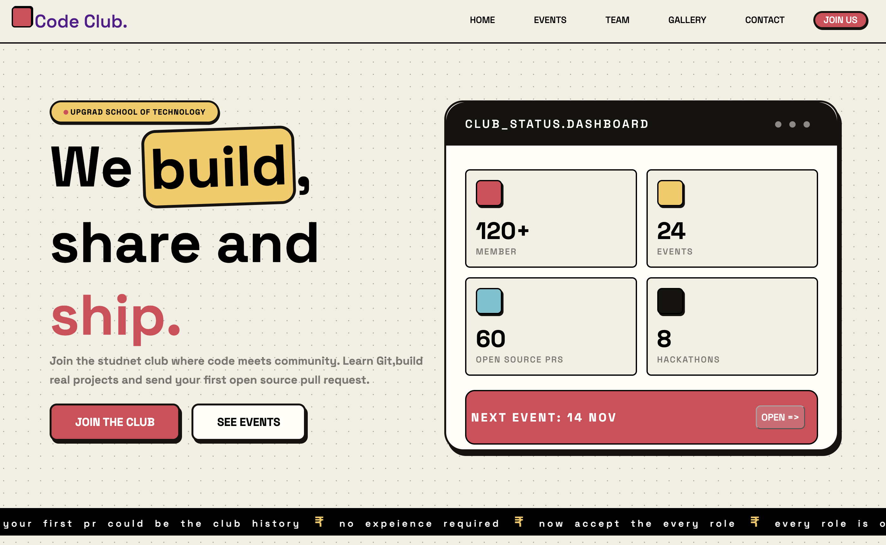

# 🚀 SOT Code Club

**Learn. Build. Collaborate. Ship.**

The official website of the **School of Technology Code Club**, built to bring students together through coding, open-source contributions, technical events, and collaboration.

🌐 **Live Website:** https://siddharth9874.github.io/SOT-CODE-CLUB/

## ✨ About the Project

SOT Code Club is a student-driven community focused on building practical skills, exploring technology, and learning together.

This website introduces the club, showcases its events and team, highlights memorable moments, and provides a way for interested students to connect with us.

## 📄 Website Pages

- 🏠 **Home** — Introduction, club overview, and highlights.
- 🎯 **Events** — Technical events and activities.
- 👥 **Team** — Meet the people behind the club.
- 🖼️ **Gallery** — Moments and memories from the community.
- 📬 **Contact** — Get in touch and explore joining the club.

## 🛠️ Tech Stack

- HTML5
- CSS3
- Google Fonts
- Git & GitHub
- GitHub Pages

## 🎨 Design Highlights

- Bold typography and vibrant colors.
- Responsive layouts for mobile and desktop.
- Shared stylesheet across all pages.
- Reusable visual design elements.
- Simple and accessible navigation.

## 📸 Website Preview

<!-- Add your website screenshot here -->
Example: 

## 📁 Project Structure

```text
SOT-CODE-CLUB/
├── index.html
├── events.html
├── team.html
├── gallery.html
├── contact.html
├── styles.css
├── images/
├── README.md
└── .gitignore
```

## 🚀 Run Locally

1. Clone the repository:

   ```bash
   git clone https://github.com/siddharth9874/SOT-CODE-CLUB.git
   ```

2. Open the project folder:

   ```bash
   cd SOT-CODE-CLUB
   ```

3. Open `index.html` in your browser.

## 🤝 Contributing

Contributions, ideas, and improvements are welcome!

1. Fork the repository.
2. Create a feature branch.
3. Make your changes.
4. Commit your work with a meaningful message.
5. Open a Pull Request.

## 💛 Built With

Made with curiosity, creativity, and a passion for technology by the SOT Code Club community.

---

**Learn together. Build together. Ship together.** 🚀